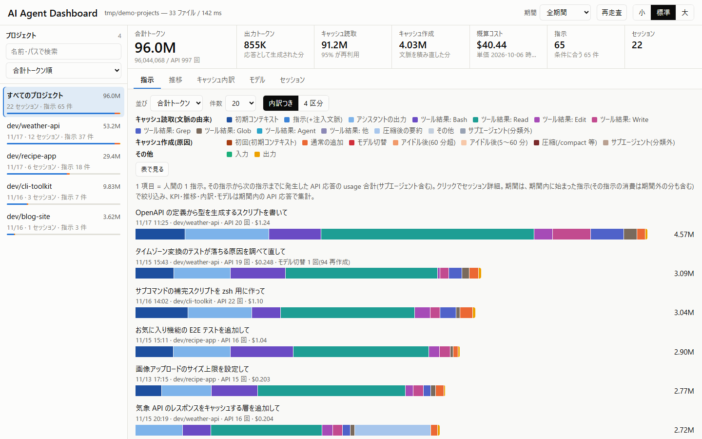

# AI Agent Dashboard

[](https://github.com/COCOQ-gh/AIAgentDashboard/actions/workflows/test.yml)
[](LICENSE)

Claude Code のトークン消費を「どの指示で・なぜ膨らんだか」まで分解して見せる、ローカル専用のダッシュボード。

> A local, zero-dependency dashboard that reads Claude Code transcripts (`~/.claude/projects/**/*.jsonl`)
> and shows which prompt consumed how many tokens, and why: cache rebuilds after a model switch, an idle gap
> or a compaction, and what the re-sent context is made of. Node.js only; nothing leaves your machine.



*画面は合成データ(`tools/make-demo-data.mjs`)で撮影したもの。*

### 作った理由

AI エージェントに長い作業を任せると、トークンの大半は「キャッシュ読取」、つまり毎回送り直される文脈に消える。
合計値だけでは、どの指示・どのツール結果・どのキャッシュ作り直しが原因なのかが分からないので、
トランスクリプトから指示単位に分解して見えるようにした。

### 技術的な見どころ

- **外部依存ゼロ** — Node.js 標準ライブラリだけで、サーバ・集計・画面・テストまで書いている
- **初回走査の並列化** — `worker_threads` で CPU 数まで並列にパースし、129 ファイル / 414 MB で逐次 3.8 秒 → 1.1 秒
  (6 コア、OS のファイルキャッシュが温まった状態)。以後は size / mtime が変わったファイルだけ再パースする
- **キャッシュ作成の原因推定** — 呼出の間隔・モデルの切替・圧縮の記録から、作り直しを
  初回 / モデル切替 / アイドル後 / 圧縮 / 通常の追加に分ける。キャッシュ読取も、初期コンテキスト・指示・出力・ツール別に概算する
- **AI エージェント自身が使える** — CLI・API で「いまのセッションの消費とコンテキスト量」を返し、エージェントが作業の進め方を調整できる
- **ローカル専用サーバとしての防御** — loopback 以外の Host、不正な Origin からの更新要求を 403 で拒否する
- **レイアウトの実測** — 「1 画面に収まる」を目視でなく、Chrome DevTools Protocol で実ブラウザを動かして測る検査ツール(`tools/shot.mjs`)
- **テスト** — `node:test` で 46 件。GitHub Actions で Ubuntu / Windows の両方で回す

## 概要

Claude Code が `~/.claude/projects/` に残すトランスクリプト(JSONL)を読み取り、
**どの指示(プロンプト)でどれだけトークンを消費したか**をブラウザで可視化するローカルツール。
外部依存なし(Node.js 18 以上のみ)。データは読み取り専用で、どこにも送信しない。

## 使い方

```bash
npm start
```

`http://127.0.0.1:4317/` を開く。初回は全ファイルを走査する。パースは worker_threads で CPU 数まで並列に行い、
実測 129 ファイル / 414 MB・6 コアで約 1.1〜1.3 秒(逐次パースだと約 3.8 秒。OS のファイルキャッシュが冷えていると
ディスク読み出しの分だけ延びる)。以後はファイルの size/mtime が変わったものだけ再パースする。「再走査」ボタンで最新化。

| 環境変数 | 既定 | 意味 |
|---|---|---|
| `CLAUDE_PROJECTS_DIR` | `~/.claude/projects` | 走査対象ディレクトリ |
| `PORT` | `4317` | 待受ポート |
| `HOST` | `127.0.0.1` | 待受アドレス(ローカル専用のまま使うこと)。名前を指定すると同じ Host hostname も許可 |
| `AIAD_SCAN_WORKERS` | CPU 数 | 並列パースのワーカー数(`0` でワーカーを使わず逐次パース) |

テスト: `npm test`

## 画面

ページ自体はスクロールしない固定高のレイアウト(上部バー / 左サイドバー / KPI 帯 + タブ + ペイン)。
スクロールするのはサイドバーとペインの内部だけ。

- **左サイドバー(プロジェクト)** — 名前・パスで検索、並び替え(合計トークン / 最近 / 名前 / セッション数)。
  選択したプロジェクトが全タブのフィルタを兼ねる。各行に使用内訳の細いバー
- **上部バー** — 期間フィルタ・再走査・文字サイズ(小 / 標準 / 大。ブラウザに記憶される)
- **KPI 帯** — 合計 / 出力 / キャッシュ読取 / キャッシュ作成 / 概算コスト(USD)/ 指示数 / セッション数。
  期間・プロジェクトを反映した値は `/api/totals` から取得する。指示・モデル・セッション・セッション詳細の各行にも
  概算 USD を出す(表ビューには「概算 USD」列)
- **タブ「指示」** — トークン消費の多い指示。1 本 = 人間の 1 指示。棒は既定で**キャッシュ内訳タブと同じ分類**で塗り分ける
  (読取 = 初期コンテキスト / 指示 / アシスタント出力 / ツール別 / 要約、作成 = 初回 / 通常の追加 / モデル切替 / アイドル後 / 圧縮、
  入力、出力。ツールチップに全項目の値)。サブエージェント分は主系列の分類対象外なので灰色の「分類外」。
  「4 区分」ボタンで従来の 4 色(読取・作成・入力・出力)に戻せる。セッション詳細の棒も同じ
  並び順・件数の選択と、20 件ずつの「もっと見る」
- **タブ「推移」** — **縦軸 = トークン量、横軸 = 時間**の積み上げ面グラフ(目盛りの数値つき)。時間別 / 日別 / 週別を切り替え、
  指標は「トークン(4 系列の積み上げ)」と「概算 USD」。API 応答(call)のタイムスタンプで振り分け、日の区切りは
  **ブラウザのローカル時刻**、週は月曜始まり。使っていない時間・日・週も 0 として並べる。マウスを重ねると区間の内訳。
  キャッシュ読取は他より桁違いに大きい(通常 98%)ので、**凡例を押して系列を外す**と他の系列の増減が見える。
  期間フィルタとサイドバーのプロジェクトで絞る
- **タブ「キャッシュ内訳」**
  - **キャッシュ作成の原因** — 初回 / モデル切替 / アイドル後(60 分超・5〜60 分)/ 圧縮 / 通常の追加。
    モデル切替・長いアイドル・圧縮は「同じ文脈の作り直し」で、指示ごとの行にも切替回数と再作成量を出す
  - **キャッシュ読取の構成(概算)** — 毎回再送されている文脈の由来: 初期コンテキスト / 人間の指示 / アシスタントの出力 /
    ツール結果(ツール別)/ 圧縮後の要約
- **タブ「モデル」** — モデル別の内訳(積み上げ色は同じ 4 系列)。API 応答(call)単位で集計するので、途中でモデルが切り替わった
  セッションも別々に数える。日付サフィックス付きの名前(`claude-haiku-4-5-20251001`)は同じモデルに畳み、`<synthetic>` は除く
- **タブ「セッション」** — セッション一覧。Claude Code の `.claude/worktrees/<name>` で動いたセッションは元リポジトリにまとめる。
  クリックすると「セッション詳細」タブにモデル別と指示ごとの内訳(時系列)
- 各グラフは「表で見る」で同じ数値を表に切り替えられる

### 画面の実測(tools/shot.mjs)

レイアウトは静的検査では証明できないので、Chrome(DevTools Protocol)で稼働中の画面を駆動して測る開発用ツール。
ページスクロールの有無・ビューポート外で到達不能に切れた要素・スクロール可能な要素・console エラーを出し、
PNG を `tmp/`(gitignore 済み)へ保存する。`--expect-no-scroll` で 1 画面に収まらなければ終了コード 1。

```bash
node tools/shot.mjs --size 1280x720 --expect-no-scroll
node tools/shot.mjs --density large --script probe.mjs   # 操作後の状態を測る
```

実データを写さずに撮る・試すときは、合成トランスクリプトを生成してそちらを読ませる
(架空の 4 プロジェクト・数日分。モデル切替・アイドル・圧縮・サブエージェントを含む。シード固定):

```bash
node tools/make-demo-data.mjs --out tmp/demo-projects
CLAUDE_PROJECTS_DIR=tmp/demo-projects PORT=4318 npm start
```

## 集計ルール(src/parse.mjs・src/scan.mjs)

- **指示** = `type: user` かつ `origin.kind === "human"` の行(旧形式は tool_result でも isMeta でもない user 行)。
  スキル本文などの注入(`isMeta`)やツール結果は指示に数えない。
- **トークン** = `type: assistant` の `message.usage`(input / cache_creation / cache_read / output)。
  1 応答は複数行に分割記録され同じ `message.id` と同じ usage を持つので、`message.id` で 1 回だけ数える。
- **帰属** = assistant 行は promptId を持たないため、同一ファイル内で「直前の指示」に帰属させる。
- **サブエージェント** = `<project>/<sessionId>/subagents/agent-*.jsonl`。先頭 user 行の `promptId` で親の指示に合流する。
- **フォーク / 再開** = 新しいセッションファイルに履歴が丸ごと複製されるため、全ファイル横断で `message.id` を
  重複排除し、複製で中身が空になった指示は落とす(開始時刻 → ファイル更新時刻の昇順で先のファイルが所有)。
- **worktree** = セッションの cwd が `<root>/.claude/worktrees/<name>` なら、プロジェクトキーと表示 cwd は `<root>` にそろえる。
  元の worktree プロジェクトキーはセッションの `worktree` に残し、プロジェクトの `worktrees` には distinct 件数を出す。

## USD 概算コスト(src/pricing.mjs)

API 応答(call)ごとに、モデル別の単価で `入力 + 出力 + キャッシュ読取 + キャッシュ書込` を足した **API 従量価格での概算**。

- 単価は `src/pricing.mjs` の表(1 百万トークンあたり USD)を**手で更新**する。更新日 `PRICING_UPDATED` を画面の KPI と CLI に出す。
  新しいモデルが出たら `MODELS` に 1 行足す。未登録のモデルは 0 円で計上し、その呼出数を「単価未登録」として別に出す
- キャッシュ書込は **5 分 TTL = 入力単価の 1.25 倍 / 1 時間 TTL = 2 倍**で分けて計算する(トランスクリプトの
  `usage.cache_creation.ephemeral_*` を使う。Claude Code の書込は実データでほぼ全て 1 時間)。内訳が無い旧形式は 5 分扱い
- キャッシュ読取の単価はモデルごとに倍率が違う(Fable 5.1 は入力の 0.025 倍、Opus 5.5 は 0.05 倍、他は 0.1 倍)
- 見ていないもの: Priority Tier・Fast mode・バッチ割引・データレジデンシーの上乗せ。サブスクリプション定額の利用者が実際に払う額ではない

## API

| パス | 内容 |
|---|---|
| `GET /api/overview` | プロジェクト別集計と全体合計 |
| `GET /api/totals?project=&since=` | KPI 合計(`usage` / `cost` / `unpricedCalls` / `apiCalls` / `prompts` / `sessions`) |
| `GET /api/prompts?project=&since=&sort=total|output|recent&limit=` | 指示一覧。`limit` は最大 5000 |
| `GET /api/sessions?project=&since=` | セッション一覧。`since` 指定時は終了時刻で絞る |
| `GET /api/session?id=` | 1 セッションの指示別内訳 |
| `GET /api/report?session=&top=` | AI エージェント向けレポート(下記 CLI と同じ JSON) |
| `GET /api/breakdown?project=&since=` | キャッシュ作成の原因とキャッシュ読取の構成(src/attribution.mjs) |
| `GET /api/models?project=&since=` | モデル別の内訳(src/models.mjs)。`/api/session` にも `modelRows` を付与 |
| `GET /api/timeseries?project=&since=&bucket=hour\|day\|week&tz=` | 時間別 / 日別 / 週別の推移(src/timeseries.mjs)。各行の `t` は区間開始(ローカル時刻を UTC として表した擬似 epoch ms)。`tz` は UTC との差(分。ブラウザの `getTimezoneOffset`)、省略は UTC |
| `POST /api/rescan` | 再走査 |

`since` の期間集計は、指示数を指示の開始時刻、セッション数を終了時刻(`endedAt >= since`)で判定し、usage / cost / API 呼出数は
call の時刻で判定する。時刻の無い call は期間指定時だけ除外する。`since` が空なら全期間で、`/api/totals` の call 集計は
`/api/overview` の全体合計と一致する。KPI 帯はこの `/api/totals` を使う。

`cost`(USD 概算)は `/api/overview`・`/api/totals`・`/api/prompts`・`/api/sessions`・`/api/session`・`/api/models`・`/api/report` の各行に付く。

全リクエストで `Host` hostname を検査し、`127.0.0.1` / `localhost` / `::1` 以外は 403 にする。`HOST=<name>` で
明示的に別名へ bind した場合はその hostname も許可する(`0.0.0.0` / `::` 自体は許可 hostname にしない)。
`POST /api/rescan` は `Origin` がある場合も同じ許可リストで検査する。

## AI エージェントから使う(CLI / スキル)

エージェント自身が「いまのセッションでどの指示にいくらトークンを使ったか」「コンテキストがどれだけ埋まったか」
「どのツールが文脈を増やしたか」を読み、作業の仕方を調整するための出力。サーバ不要で、走査は cwd に対応する
`~/.claude/projects/<key>/` だけ(1 秒以内)。

```bash
npm run usage                                  # $CLAUDE_CODE_SESSION_ID のセッション(無ければ cwd の最新)を Markdown で
npm run usage -- --list                        # cwd のプロジェクトのセッション一覧
npm run usage -- --session <id> --format json  # 機械可読
npm run usage -- --project <key>               # cwd に関係なく、そのプロジェクトの最新セッション
```

`--project <key>` に未知のキーを渡すと `project not found` で終了する。CLI の Markdown に出す時刻はローカル時刻。

Claude Code では `/token-usage` スキル(`.claude/commands/token-usage.md`)が CLI を実行し、提案に沿って進め方を
変える(コンテキスト 70% 超で /compact・探索はサブエージェントへ委任・大きなファイルは範囲指定で読む、など)。

レポートの内容: 合計と内訳 / 現在のコンテキスト量(推定)/ 提案 / 消費の多い指示 / ツール別の文脈追加(概算)/ 指示の時系列。

- **コンテキスト量** = 最後の API 呼出の `input + cache_read + cache_creation`(その呼出でモデルに渡した全トークン)。
  窓の大きさはモデル名から推定する(`AIAD_CONTEXT_WINDOW` か `--window` で上書き)。
- **ツール別の文脈追加** = 「次の呼出で新たに入力されたトークン(`input + cache_creation`)」を、直前の呼出が使った
  ツールへ等分した概算。ツール結果(ファイル読み込み・コマンド出力)が文脈をどれだけ増やしたかの目安。
- **サブエージェント**(sidechain)の消費は合計に含むが、親のコンテキスト量には含めない。
- **`<synthetic>` call** は合計には含むが、キャッシュ作成原因・モデル切替の分類とコンテキスト量の推定からは除く。
- **キャッシュ作成の原因** = 主系列の各呼出を直前の呼出と比べて分類: model が違えば「モデル切替」、60 分超空けば
  「アイドル後(60 分超)」、文脈が 30% 超縮めば「圧縮」、5 分超空けば「アイドル後(5〜60 分)」、それ以外は「通常の追加」。
  プロンプトキャッシュはモデル別・TTL 付きなので、前三者は文脈全体の作り直しになる。
- **キャッシュ読取の構成** = 文脈に積まれた内容の由来(初期コンテキスト / 指示 / 直前の出力 / 直前の呼出のツール結果 /
  圧縮後の要約)を呼出ごとに台帳で追跡し、各呼出の cache_read を構成比で按分した概算。

## 開発プロセス

AI エージェント(Claude Code)と自作のタスクループ(調査 → 計画 → 実行 → 評価 → 蒸留)で開発した。
コミットの `TASK-…` がタスク 1 件に対応し、本文に変更内容と検証結果を書いている。
過去のタスクで前提ズレや無駄を生んだ手順は、再発防止として `CLAUDE.md` に固定している。
タスクループのフレームワーク本体と各タスクの詳細な作業記録は非公開。
